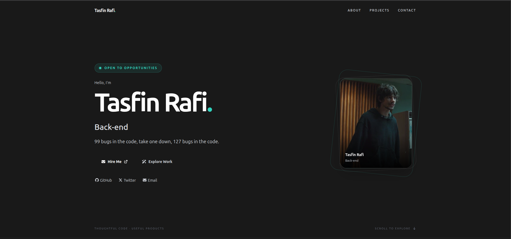
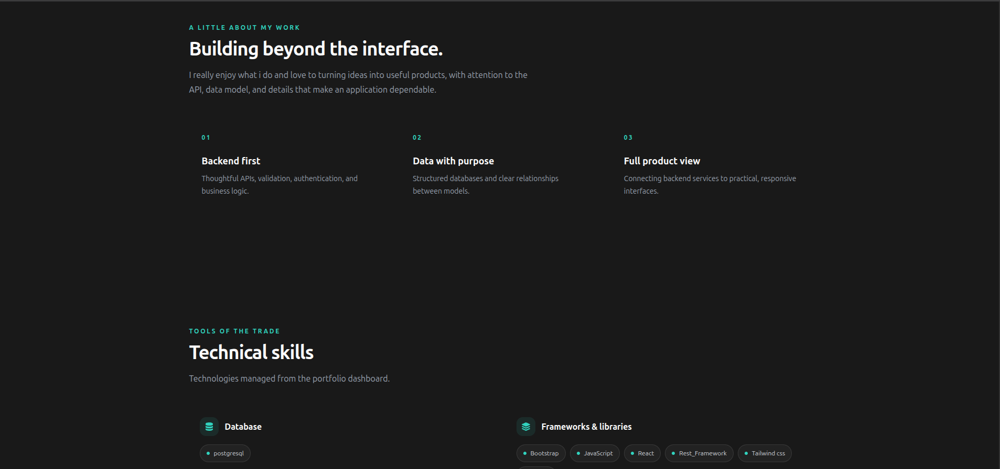
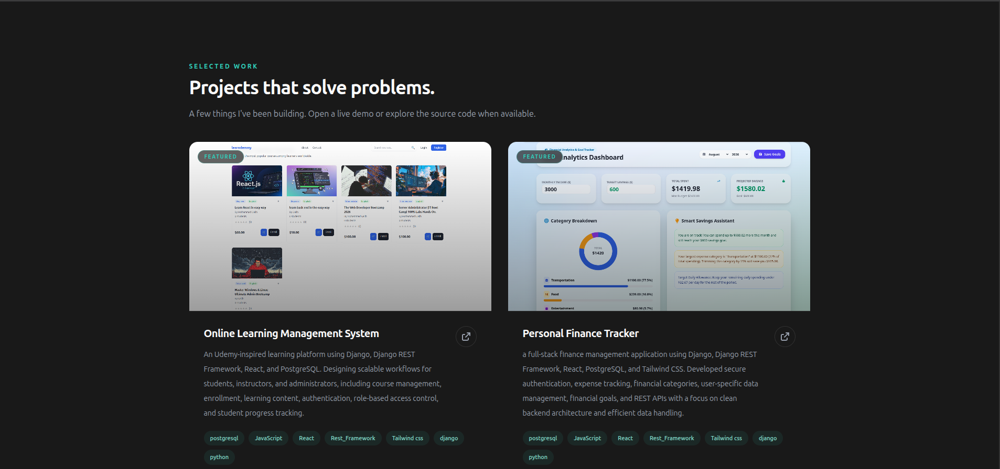
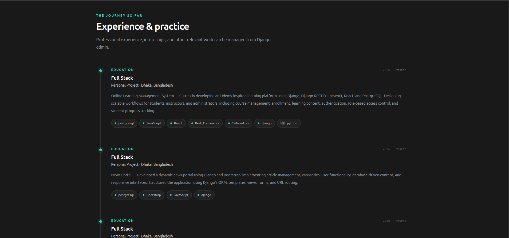

# DEVELOPER PERSONAL PORTFOLIO 

My personal developer portfolio built with **React, Vite, Tailwind CSS, Farmer motion. django rest framework, and SQLite**, profile details, skills, experience, and projects are managed through django admin panel, 

## Project structure

```text
.
├── backend/
│   ├── api/
│   │   ├── migrations/
│   │   └── ...
│   ├── core/
│   ├── media/             
│   ├── .env.example
│   └── requirements.txt
├── frontend/
│   ├── public/
│   ├── src/
│   ├── .env.example
│   └── package.json
└── .gitignore
```

## Screenshots

### Homepage 


### About 


### Projects 


### Experiences 



## Features

- Responsive dark design with subtle motion and reduced-motion support
- Django-powered profile, project, experience, and technology data
- Project cards with featured labels, screenshots, technology tags, and optional demo/source    links
- Resume, avatar, and technology icon support
- Contact form with validation, visible success/error states, and API rate limiting
- Django admin for editing portfolio content
- Environment-based API URL and Django settings
- Sample public portfolio fixture (no admin users or contact messages included)


## REQUIREMENTS 
- python 3.12 or newer
- Node.js and npm 
- Git 
